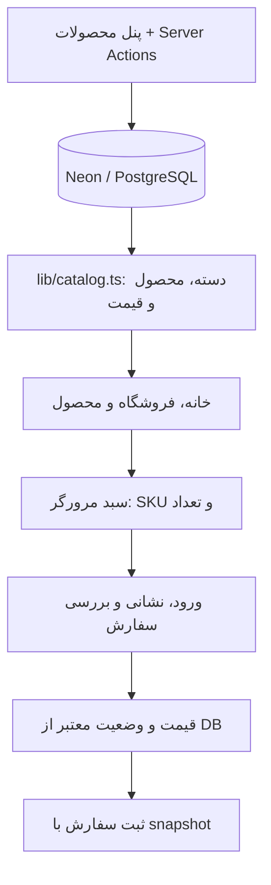
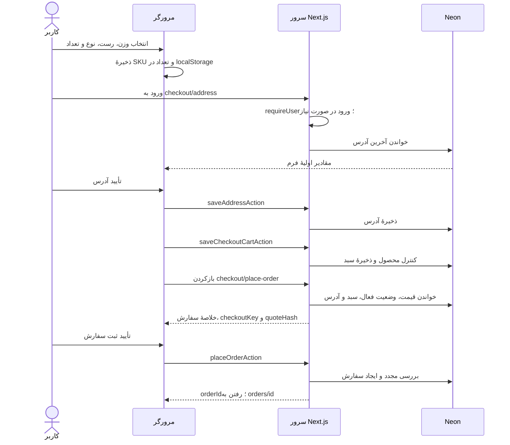
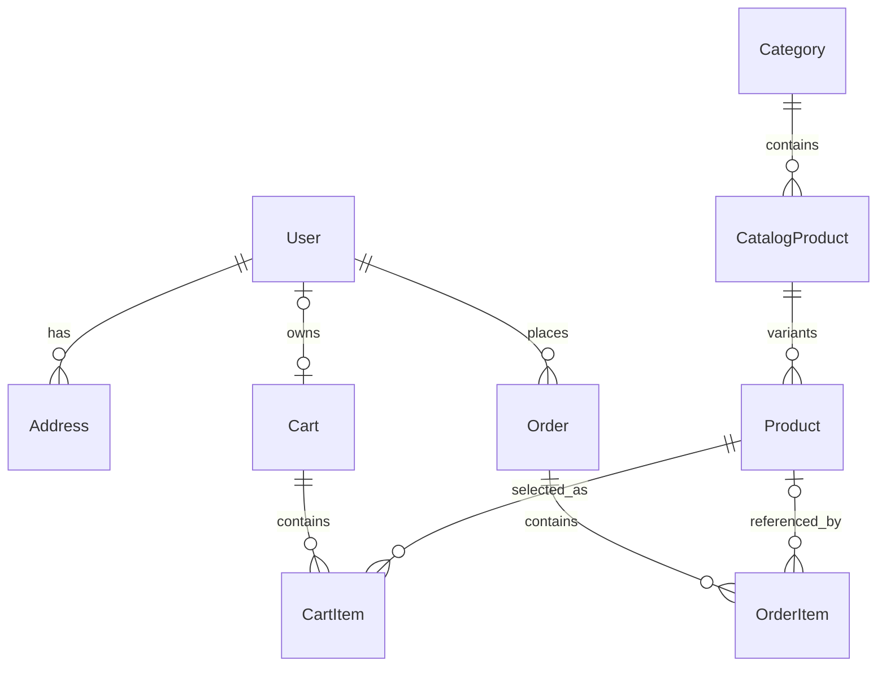

# راهنمای ساختار پروژهٔ آ

این سند نقشهٔ وضعیت فعلی پروژه است: هر بخش کجا قرار دارد، اطلاعات از کجا می‌آید، خرید چگونه ثبت می‌شود و برای فیچر بعدی باید سراغ چه فایل‌هایی برویم.

به‌روزرسانی کاتالوگ و مدیریت محصولات: `2026-10-23`. مرجع زندهٔ محصولات اکنون دیتابیس است و migration و انتقال اولیه روی Neon اجرا شده‌اند. برای انتقال داده و تنظیم آپلود، [راهنمای مدیریت محصولات](docs/products-admin.md) را بخوانید. موجودی همچنان خارج از محدوده است؛ قیمت و وضعیت فعال بودن در checkout کنترل می‌شوند.

## ۱. تصویر کلی در یک نگاه

پروژه یک برنامهٔ **Next.js با App Router** است. فرانت‌اند و بک‌اند در همین مخزن و همین برنامه قرار دارند؛ سرور Express یا پروژهٔ بک‌اند جداگانه نداریم.

سه محل اصلی نگه‌داری اطلاعات داریم:

| محل | چه چیزی در آن است؟ | نمونه |
| --- | --- | --- |
| کد پروژه | نوع‌ها، قالب نمایش و محاسبات؛ آرشیو قدیمی فقط برای انتقال/تست | `lib/storefront.ts` و `lib/product-pricing.ts` |
| مرورگر کاربر | سبد خرید اولیه و انتخاب تم | `localStorage` |
| PostgreSQL روی Neon | دسته‌ها، محصولات مادر، SKUها، قیمت‌ها، کاربران، آدرس، سبد و سفارش | مدل‌های Prisma |

**نکتهٔ اصلی:** فروشگاه، سبد مرورگر و checkout کاتالوگ و قیمت را از دیتابیس می‌گیرند. ساخت و ویرایش از پنل محصولات انجام می‌شود؛ seed دیگر تغییرهای ادمین را بازنویسی نمی‌کند.



## ۲. ابزارهای اصلی و کاربردشان

نسخه‌ها از [package.json](package.json) نقل شده‌اند؛ نسخهٔ دقیق نصب وابستگی‌هایی که بازه دارند در `package-lock.json` ثبت می‌شود.

| ابزار | نسخهٔ اعلام‌شده | نقش |
| --- | --- | --- |
| Next.js | `16.3.4` | صفحات، روت‌ها، رندر سرور، Server Actions و API احراز هویت |
| React | `19.2.8` | ساخت رابط کاربری و تعامل‌ها |
| TypeScript | `^5` | کنترل نوع داده‌ها هنگام توسعه |
| Tailwind CSS | `^4` | استایل‌های utility در کنار CSS اختصاصی پروژه |
| shadcn/ui و Radix | کامپوننت‌های محلی | دکمه، ورودی و منوی کاربر |
| Prisma و Neon adapter | `^7.10.0` | ارتباط کد با PostgreSQL و تعریف ساختار دیتابیس |
| next-auth / Auth.js | `^5.0.0-beta.32` | ورود با ایمیل و رمز عبور و session |
| Zod | `^4.5.4` | اعتبارسنجی دادهٔ ورودی |
| React Hook Form | `^7.87.0` | مدیریت فرم و نمایش خطاهای فیلدها |
| bcryptjs | `^3.0.3` | هش‌کردن و بررسی رمز عبور |
| Sonner | `^2.0.8` | toastها |
| Recharts | `^3.10.1` | نمودار درآمد و تعداد سفارش در داشبورد مدیریت |
| Lucide | `^1.42.0` | آیکون‌ها |
| Playwright | `^1.63.0` | تست مرورگر در اندازهٔ دسکتاپ و موبایل |

فونت وزیرمتن از پکیج محلی بارگذاری می‌شود. زبان صفحه فارسی و جهت کلی `rtl` است.

## ۳. پوشه‌ها چه مسئولیتی دارند؟

```text
acoffee/
├── app/                         صفحات، layoutها و کامپوننت‌های اختصاصی سایت
│   ├── layout.tsx               قاب مشترک تمام صفحات
│   ├── page.tsx                 صفحهٔ اصلی
│   ├── (auth)/                  layout مشترک ورود و ثبت‌نام
│   ├── api/auth/[...nextauth]/   تنها Route Handler فعلی
│   ├── shop/                    فروشگاه، دسته‌ها و جزئیات محصول
│   ├── cart/                    صفحه و state سبد مرورگر
│   ├── checkout/                ثبت آدرس و بررسی سفارش
│   ├── orders/[id]/             نمایش سفارش کاربر
│   ├── account/                 حساب کاربری
│   ├── about/                   دربارهٔ برند
│   └── guide/                   راهنمای دم‌آوری
├── actions/                     عملیات سرور برای کاربر، آدرس، سبد و سفارش
├── lib/                         منطق مشترک، دیتابیس، کاتالوگ و محاسبات
│   └── validators/              schemaهای Zod
├── components/ui/               اجزای عمومی shadcn
├── prisma/                      schema، migrationها و seedها
├── generated/prisma/            Prisma Client تولیدشده
├── public/images/               تصاویر قابل استفاده در سایت
├── tests/unit/                  تست منطق و اعتبارسنجی
├── tests/ui/                    تست صفحات در مرورگر
├── scripts/                     اسکریپت مقایسهٔ قیمت‌ها
├── types/                       تکمیل typeهای NextAuth
├── docs/                        مستندات جزئی‌تر مراحل قبلی
├── artifacts/                   خروجی تست، گزارش و کارهای تصویری
├── auth.ts                      تنظیمات اصلی احراز هویت
├── prisma.config.ts             تنظیمات CLI پرایزما
└── package.json                 وابستگی‌ها و فرمان‌های پروژه
```

`@/` در importها به ریشهٔ همین پروژه اشاره می‌کند؛ مثلاً `@/lib/db` همان `lib/db.ts` است. پوشهٔ `src` نداریم.

کامپوننت اختصاصی هر صفحه معمولاً کنار `page.tsx` همان صفحه است؛ مثل `product-purchase.tsx` کنار صفحهٔ محصول. اجزای مشترک فروشگاه در `app/shop` و اجزای مشترک کل سایت مثل هدر در `app` قرار دارند. `components/ui` محل اجزای عمومی و قابل استفادهٔ مجدد است.

## ۴. نقشهٔ تمام روت‌ها

در App Router، فایل `page.tsx` یک صفحه و `route.ts` یک endpoint سرور می‌سازد. پوشهٔ `[slug]` یعنی بخش متغیر URL؛ پوشهٔ `(auth)` صرفاً گروه‌بندی است و در URL دیده نمی‌شود.

| آدرس | فایل | دسترسی و کاربرد |
| --- | --- | --- |
| `/` | [app/page.tsx](app/page.tsx) | عمومی؛ هیرو، دسته‌ها و اسلایدرها، معرفی برند و راهنمای دم‌آوری |
| `/shop` | [app/shop/page.tsx](app/shop/page.tsx) | عمومی؛ مجموعهٔ اسلایدرهای دسته‌ها |
| `/shop/category/[category]` | [صفحهٔ دسته](app/shop/category/[category]/page.tsx) | عمومی؛ تمام محصولات یک دسته؛ دستهٔ نامعتبر ۴۰۴ |
| `/shop/[slug]` | [صفحهٔ محصول](app/shop/[slug]/page.tsx) | عمومی؛ انتخاب وزن، رست، نوع و تعداد؛ محصول نامعتبر ۴۰۴ |
| `/about` | [دربارهٔ ما](app/about/page.tsx) | عمومی؛ محتوای معرفی برند |
| `/guide` | [راهنمای دم‌آوری](app/guide/page.tsx) | عمومی؛ محتوای آموزشی |
| `/cart` | [سبد خرید](app/cart/page.tsx) | عمومی؛ سبد ذخیره‌شده در مرورگر |
| `/login` | [صفحهٔ ورود](<app/(auth)/login/page.tsx>) | ورود؛ کاربر واردشده به مقصد معتبر هدایت می‌شود |
| `/register` | [صفحهٔ ثبت‌نام](<app/(auth)/register/page.tsx>) | ایجاد حساب؛ رفتار مشابه ورود برای کاربر واردشده |
| `/account` | [حساب کاربری](app/account/page.tsx) | نیازمند ورود؛ اطلاعات حساب و آخرین ۲۰ سفارش |
| `/orders` | [تاریخچهٔ سفارش‌ها](app/orders/page.tsx) | نیازمند ورود؛ سفارش‌های خود کاربر از جدیدترین، صفحه‌بندی سمت دیتابیس هر صفحه ۵ سفارش، وضعیت پرداخت/ارسال با پس‌زمینهٔ سبز یا قرمز، تاریخ شمسی و لینک جزئیات |
| `/admin` | [داشبورد مدیریت](app/admin/page.tsx) | فقط ADMIN؛ درآمد پرداخت‌شده، تعداد سفارش و بسته، میانگین مبلغ و نمودار Recharts؛ بازه‌های ۷، ۳۰ و ۹۰ روز یا ماه و سال شمسی |
| `/admin/users` | [مدیریت کاربران](app/admin/users/page.tsx) | فقط ADMIN؛ صفحه‌بندی ۲۰تایی، تغییر نقش و حذف حساب بدون سفارش |
| `/admin/orders` | [مدیریت سفارش‌ها](app/admin/orders/page.tsx) | فقط ADMIN؛ جدیدترین سفارش‌ها، صفحه‌بندی ۲۰تایی، نام خریدار، اقلام و تاریخ پرداخت/تحویل، حذف با تأیید |
| `/admin/orders/[id]` | [جزئیات مدیریتی سفارش](app/admin/orders/[id]/page.tsx) | فقط ADMIN؛ نشانی و مبالغ، تغییر تأیید پرداخت/تحویل و حذف اتمیک سفارش و اقلام |
| `/checkout/address` | [آدرس ارسال](app/checkout/address/page.tsx) | نیازمند ورود؛ دریافت و ویرایش آدرس قبلی |
| `/checkout/place-order` | [بررسی سفارش](app/checkout/place-order/page.tsx) | نیازمند ورود؛ قیمت‌های سرور، آدرس و دکمهٔ ثبت سفارش |
| `/orders/[id]` | [جزئیات سفارش](app/orders/[id]/page.tsx) | نیازمند ورود و مالکیت سفارش؛ سفارش دیگران ۴۰۴ |
| `/api/auth/[...nextauth]` | [Auth Route Handler](app/api/auth/[...nextauth]/route.ts) | handlerهای `GET` و `POST` متعلق به Auth.js |

حفاظت صفحه‌ها داخل خودشان با `requireUser` انجام می‌شود؛ فایل `middleware.ts` یا `proxy.ts` برای حفاظت سراسری نداریم. Server Actionهای حساس هم مستقلاً کاربر را بررسی می‌کنند؛ حفاظت صفحه به‌تنهایی جای این بررسی را نمی‌گیرد.

پارامتر `next` در صفحات ورود/ثبت‌نام مقصد بعد از ورود را مشخص می‌کند. [safeAuthRedirect](lib/auth-redirect.ts) فقط مقصدهای مجاز داخلی را می‌پذیرد؛ اضافه‌کردن مقصد جدید ممکن است به تغییر این فایل هم نیاز داشته باشد.

خطاهای حساب، checkout و جزئیات سفارش `error.tsx` مخصوص دارند. صفحهٔ ۴۰۴ عمومی در [app/not-found.tsx](app/not-found.tsx) است. عنوان و توضیحات کلی سایت در layout و metadata اختصاصی محصول و دسته در صفحات مربوطه تعریف می‌شود.

مسیرهای مدیریت محصولات: `/admin/products` برای لیست، `/admin/products/new` برای ساخت، `/admin/products/[id]/edit` برای ویرایش؛ همگی محافظت‌شده برای ADMIN هستند.

## ۵. فرانت‌اند چگونه کنار هم قرار گرفته است؟

### قاب سایت و اجزای اصلی

[app/layout.tsx](app/layout.tsx) هدر، فوتر، فونت، CSS، تنظیم اولیهٔ تم و محل نمایش toast را دور تمام صفحات قرار می‌دهد. همچنین session را روی سرور می‌خواند و نام/ایمیل کاربر را به هدر می‌دهد.

| فایل | مسئولیت |
| --- | --- |
| [site-header.tsx](app/site-header.tsx) | ناوبری، منوی موبایل، تعداد سبد، تغییر تم و منوی کاربر |
| [user-menu.tsx](app/user-menu.tsx) | حرف اول نام کاربر، حساب و خروج؛ یا ورود/ثبت‌نام برای مهمان |
| [site-footer.tsx](app/site-footer.tsx) | فوتر مشترک |
| [home-hero.tsx](app/home-hero.tsx) | هیرو صفحهٔ اصلی |
| [shop-catalog.tsx](app/shop/shop-catalog.tsx) | لینک دسته‌ها و ساخت یک اسلایدر برای هر دسته |
| [category-slider.tsx](app/shop/category-slider.tsx) | اسلایدر افقی RTL، کنترل حرکت و جابه‌جایی خودکار هر ۳ ثانیه |
| [product-card.tsx](app/shop/product-card.tsx) | کارت محصول، وزن‌های موجود، انواع و قیمت «از» |
| [product-visual.tsx](app/shop/product-visual.tsx) | قاب تصویر محصول با استفاده از تصویر مشترک سایت |
| [product-purchase.tsx](app/shop/[slug]/product-purchase.tsx) | انتخاب وزن/رست/نوع/تعداد و اضافه‌کردن انتخاب دقیق به سبد |
| [cafe-offer.tsx](app/shop/cafe-offer.tsx) | بخش سفارش عمده؛ راه ارتباط از تنظیم کاتالوگ خوانده می‌شود |

دسته‌های بالای اسلایدرها لینک به همان بخش صفحه هستند؛ فیلتر حذف/نمایش دسته‌ها نیستند. «مشاهدهٔ همه» صفحهٔ مستقل آن دسته را باز می‌کند. حرکت خودکار اسلایدر در حالت‌هایی مانند مخفی‌شدن صفحه، تعامل کاربر و درخواست کاهش حرکت متوقف می‌شود.

صفحه‌ها و قسمت‌های داده‌خوان عمدتاً **Server Component** هستند: روی سرور اجرا می‌شوند و می‌توانند مستقیماً داده بخوانند. اجزای تعاملی با `'use client'` مشخص‌اند؛ مثل فرم‌ها، انتخاب محصول، هدر و تغییر تم.

برای state ساده از `useState` و برای سبد و تم از `useSyncExternalStore` استفاده شده است. Redux، Zustand، React Query یا `SessionProvider` سراسری در ساختار فعلی وجود ندارد.

### استایل، تم و تصویر

| فایل | نقش |
| --- | --- |
| [globals.css](app/globals.css) | چیدمان عمومی، اجزای فروشگاه و رفتار responsive |
| [auth.css](app/auth.css) | فرم‌های احراز هویت و بخش‌های مرتبط با کاربر |
| [brand-theme.css](app/brand-theme.css) | رنگ‌ها و اصلاحات تم، تصویرها و روبان تخفیف |
| [checkout.css](app/checkout/checkout.css) | ظاهر آدرس، بررسی سفارش و بخش‌های مرتبط با سفارش |
| [theme.ts](app/theme.ts) | تم پیش‌فرض و اسکریپت اعمال تم پیش از نمایش صفحه |
| [use-theme.ts](app/use-theme.ts) | خواندن/تغییر تم و هماهنگی با مرورگر |
| [theme-toggle.tsx](app/theme-toggle.tsx) | دکمهٔ تغییر تم با آیکون |
| [storefront-image.tsx](app/storefront-image.tsx) | نمایش تصویر مناسب تم با `next/image` |

تم پیش‌فرض `dark` است. انتخاب کاربر در کلید `acoffee:theme` ذخیره و روی `data-theme` عنصر `html` اعمال می‌شود. اسکریپت اولیه کمک می‌کند صفحه ابتدا با تم اشتباه نمایش داده نشود.

تصویر تم روشن، فایل اصلی [acoffee.jpg](public/images/acoffee.jpg) است؛ تم تیره از [acoffee-cinematic.png](public/images/acoffee-cinematic.png) استفاده می‌کند. نگاشت این دو در `storefrontImages` داخل کاتالوگ است. کامپوننت تصویر دو نسخه دارد و CSS نسخهٔ مناسب تم را نمایش می‌دهد. تصویر اختصاصی CatalogProduct در کارت، صفحهٔ محصول و سبد خوانده می‌شود؛ نبود تصویر از همین عکس‌های متناسب با تم استفاده می‌کند.

### رفتار بستهٔ ۱۰ کیلویی

کارت‌های عمده در صفحهٔ اصلی روبان «۳٪ تخفیف / بستهٔ ۱۰ کیلویی» دارند. لینک تصویر، نام و دکمهٔ همان کارت `?weight=10000` دارد؛ بنابراین صفحهٔ محصول با وزن ۱۰ کیلو باز می‌شود.

صفحهٔ محصول فقط وزن‌های مجاز همان محصول را از query می‌پذیرد. بدون query معتبر، محصولات عادی با ۲۵۰ گرم و عمده با اولین وزن، یعنی ۵ کیلو، باز می‌شوند. در جزئیات محصول، روبان با انتخاب ۱۰ کیلو دیده می‌شود و با انتخاب ۵ کیلو پنهان می‌شود؛ اتصال آن به انتخاب وزن با `data-weight` و selector `:has(...)` در CSS است. تغییر انتخاب وزن، URL را بازنویسی نمی‌کند.

قیمت «از» روی کارت، کمترین قیمت تمام انتخاب‌های آن محصول است؛ لزوماً قیمت بستهٔ ۱۰ کیلویی لینک‌شده نیست.

## ۶. دادهٔ محصول، دسته و SKU

مرجع خواندن فروشگاه [lib/catalog.ts](lib/catalog.ts) است. Category نام، ترتیب و پیش‌فرض‌ها را نگه می‌دارد؛ CatalogProduct اطلاعات مشترک یک قهوه و Product انتخاب دقیق وزن/رست/نوع آن است. ۲۳ محصول اولیه از آرشیو به دیتابیس منتقل می‌شوند؛ ادمین می‌تواند محصول و دستهٔ جدید بسازد.

`lib/storefront.ts` فقط کمک‌تابع‌ها و نوع‌های قابل استفاده در مرورگر دارد: `productVariant` انتخاب ثبت‌شده را پیدا می‌کند، `productVariants` انتخاب‌های یک محصول را می‌دهد و `startingPrice` کمترین قیمت فعال را محاسبه می‌کند. آرایهٔ سراسری محصولات و findVariant ثابت از مسیر فروش حذف شده‌اند.

| شناسه | کاربرد |
| --- | --- |
| CatalogProduct.id | شناسهٔ داخلی ویرایش در پنل |
| CatalogProduct.slug / StoreProduct.slug | لینک ثابت محصول؛ با تغییر نام عوض نمی‌شود |
| Product.id | شناسهٔ داخلی انتخاب، مورد استفاده در CartItem و OrderItem |
| Product.slug / productId سبد مرورگر | SKU متنی، مثل `cafe-blend-robusta-100--500-medium-vip` |

SKUهای قبلی حفظ می‌شوند. حذف محصول یا یکی از انتخاب‌ها، snapshot سفارش‌های قدیمی را تغییر نمی‌دهد. پیش‌فرض دسته‌ها و جزئیات فرم در [مدیریت محصولات](docs/products-admin.md) آمده است.

## ۷. قیمت‌ها دقیقاً کجا محاسبه می‌شوند؟

[lib/product-pricing.ts](lib/product-pricing.ts) محاسبات مشترک فرم و سرور را انجام می‌دهد. قیمت یک کیلو برای هر نوع در CatalogProduct.basePrices و قیمت نهایی هر انتخاب در Product.price نگه‌داری می‌شود.

- قیمت عادی = نرخ یک کیلو × وزن به گرم / ۱۰۰۰.
- ۱۰ کیلوی عمده = قیمت نهایی ۵ کیلو × ۲ × ۹۷٪؛ اگر ۵ کیلو عرضه نشود، نرخ کیلویی مبناست.
- قیمت دستی هر انتخاب اولویت دارد. `manualPrice=true` مانع بازنویسی آن با نرخ پایه می‌شود.
- محاسبات BigInt و گردکردن به تومان صحیح‌اند؛ null یعنی اعلام‌نشده و خرید آن مسدود است.
- انتقال، قیمت‌های فعلی را دستی نگه می‌دارد. نمایش تاریخی روبان حفظ می‌شود؛ تخفیف محصولات جدید از محاسبهٔ واقعی می‌آید. checkout تخفیف ۳٪ دیگری اعمال نمی‌کند.

[lib/pricing.ts](lib/pricing.ts) همچنان فرمول مقایسهٔ درصد عربیکا/روبوستا را دارد؛ آن فرمول خودکار قیمت محصولات را عوض نمی‌کند. `npm run prices:compare` فقط قیمت‌های آرشیو پیش از انتقال را مقایسه می‌کند.

## ۸. منبع اصلی هر داده کجاست؟

| داده | مرجع |
| --- | --- |
| نام، دسته، انتخاب‌ها و عکس | Category / CatalogProduct / Product در Neon |
| قیمت نمایشی و قیمت checkout | Product.price؛ سرور هنگام ثبت سفارش دوباره می‌خواند |
| سبد مرورگر | localStorage؛ فقط SKU و تعداد |
| سبد مرحلهٔ بررسی | Cart و CartItem |
| آدرس پیشنهادی | آخرین Address کاربر |
| قیمت و نشانی سفارش قدیمی | snapshot داخل Order و OrderItem |

`scripts/migrate-catalog.ts` با audit فقط‌خواندنی شروع می‌شود و با `--apply` انتقال را انجام می‌دهد. CatalogImport اجرای مجدد را بی‌اثر می‌کند؛ تغییرهای ادمین بازنویسی و محصول حذف‌شده دوباره ساخته نمی‌شود. برای شروع از این نسخه، ابتدا migration و import انجام شود؛ جزئیات در [راهنمای انتقال](docs/products-admin.md).

## ۹. سبد خرید مرورگر

[app/cart/cart-store.ts](app/cart/cart-store.ts) یک hook به نام `useCart` دارد. داده در کلید `acoffee:preview-cart:v1` با این شکل ذخیره می‌شود:

```json
[
  {
    "productId": "cafe-blend-robusta-100--500-medium-vip",
    "quantity": 2
  }
]
```

قیمت یا آدرس داخل این داده ذخیره نمی‌شود. نام و قیمت نمایشی از روی SKU در کاتالوگ فعلی پیدا می‌شوند. ورودی با ساختار نامعتبر حذف، اقلام تکراری ادغام و تعداد هر SKU حداکثر ۱۰۰ می‌شود؛ انتخاب حذف‌شده/غیرفعال در صفحهٔ سبد پیام روشن دارد و checkout را مسدود می‌کند؛ این سقف محدودیت تعداد هر قلم سفارش است و ارتباطی با موجودی انبار ندارد.

`useCart` توابع `add` و `setQuantity`، تعداد کل `count` و وضعیت آماده‌شدن دادهٔ مرورگر `hydrated` را می‌دهد. تعداد صفر باعث حذف قلم می‌شود. تغییرات با event داخلی و رویداد `storage` بین اجزا و تب‌ها منتقل می‌شوند؛ اگر storage قابل استفاده نباشد، نگه‌داری موقت در حافظهٔ همان تب وجود دارد.

اضافه‌شدن محصول toast با عمل «برو به سبد خرید» دارد. سبد فعلی هنگام ورود خودکار از دیتابیس بازیابی یا با آن ادغام نمی‌شود، به حساب خاصی وابسته نیست و هنگام خروج یا ثبت سفارش خودکار پاک نمی‌شود. ستون‌های سبد مهمان در دیتابیس تعریف شده‌اند، اما مسیر جاری مهمان از همین سبد مرورگر استفاده می‌کند.

## ۱۰. احراز هویت و دسترسی

مرکز تنظیمات [auth.ts](auth.ts) است. فقط provider از نوع **Credentials** با ایمیل و رمز عبور داریم. session از نوع **JWT با `maxAge` چهارده روز** است؛ جدول‌های `Session`، `Account` و `VerificationToken` یا Prisma Adapter برای session نداریم.

### مسیر ورود و ثبت‌نام

1. فرم با React Hook Form و Zod داده را بررسی می‌کند.
2. `loginAction` یا `registerAction` روی سرور دوباره اعتبارسنجی می‌کند.
3. ایمیل trim و lowercase می‌شود؛ محدودیت تعداد تلاش در دیتابیس بررسی می‌شود.
4. در ورود، هش رمز از دیتابیس خوانده و با bcrypt مقایسه می‌شود. در ثبت‌نام، رمز با cost برابر ۱۲ هش می‌شود و کاربر با نقش `CUSTOMER` ساخته می‌شود.
5. Auth.js شناسه و نقش معتبر کاربر را وارد JWT/session می‌کند. پس از ثبت‌نام، ورود خودکار امتحان می‌شود؛ اگر موفق نشود کاربر به صفحهٔ ورود هدایت می‌شود.
6. مقصد بعد از ورود از `safeAuthRedirect` عبور می‌کند.

| فایل | مسئولیت |
| --- | --- |
| [auth.ts](auth.ts) | provider، بررسی رمز، callbacks و تنظیم عمر session |
| [user.actions.ts](actions/user.actions.ts) | ورود، ثبت‌نام و خروج |
| [current-user.ts](lib/current-user.ts) | `getCurrentUser` برای خواندن کاربر فعلی از دیتابیس و `requireUser` برای حفاظت صفحه |
| [auth-redirect.ts](lib/auth-redirect.ts) | محدودکردن مقصد بازگشت به مسیرهای معتبر |
| [auth-rate-limit.ts](lib/auth-rate-limit.ts) | شمارندهٔ پایدار و اتمیک تلاش‌ها در دیتابیس |
| [auth-error.ts](lib/auth-error.ts) | ثبت کنترل‌شدهٔ خطاهای احراز هویت و عملیات مرتبط |
| [types/next-auth.d.ts](types/next-auth.d.ts) | اضافه‌کردن `id` و `role` به typeهای session و JWT |

محدودیت فعلی بر اساس **عملیات و ایمیل** است: ۸ تلاش ورود در ۱۵ دقیقه و ۳ تلاش ثبت‌نام در یک ساعت. این شمارنده IP-based نیست و تلاش موفق هم مصرف می‌کند. با پایان بازه، تلاش بعدی شمارنده را بازنشانی می‌کند؛ job جداگانه‌ای برای پاک‌کردن ردیف‌های قدیمی نداریم.

`getCurrentUser` فقط به اطلاعات JWT اکتفا نمی‌کند؛ کاربر را مجدداً از دیتابیس می‌خواند. نتیجه در محدودهٔ رندر با `cache` React قابل استفادهٔ مجدد است. دیتابیس به‌صورت پیش‌فرض `passwordHash` را از خروجی queryهای کاربر حذف می‌کند؛ بررسی رمز در auth آن را صریحاً درخواست می‌کند.

نقش‌های `CUSTOMER` و `ADMIN` وجود دارند. `requireAdmin` نقش فعلی کاربر را از دیتابیس بررسی می‌کند؛ مهمان به ورود و مشتری به حساب خود هدایت می‌شود. این کنترل هم در layout مدیریت و هم پیش از خواندن آمار در `lib/admin-dashboard.ts` انجام می‌شود. هدر برای session مدیر دکمهٔ پنل دارد. بازیابی رمز، تأیید ایمیل، ورود پیامکی و OAuth نداریم.

## ۱۱. بک‌اند و APIها

بیشتر عملیات نوشتن با **Server Action** انجام می‌شود: تابعی با `'use server'` که فرم یا کامپوننت آن را فراخوانی می‌کند و اجرای واقعی آن روی سرور است. بنابراین نداشتن REST API جداگانه برای سفارش به معنی نداشتن بک‌اند نیست.

| فایل | تابع‌های قابل فراخوانی | کار اصلی |
| --- | --- | --- |
| [user.actions.ts](actions/user.actions.ts) | `loginAction`، `registerAction`، `logoutAction`، `manageUserAction` | ورود، ایجاد حساب، خروج و مدیریت نقش/حذف کاربر با کنترل ADMIN |
| [address.actions.ts](actions/address.actions.ts) | `saveAddressAction` | ایجاد اولین آدرس یا به‌روزرسانی آخرین آدرس کاربر |
| [cart.actions.ts](actions/cart.actions.ts) | `saveCheckoutCartAction` | تبدیل SKUهای مرورگر به شناسهٔ محصول DB و جایگزینی سبد checkout |
| [order.actions.ts](actions/order.actions.ts) | `placeOrderAction` | بررسی مجدد quote و ایجاد سفارش همراه با اقلام و آدرس ثابت |

مدیریت محصول در [product.actions.ts](actions/product.actions.ts) شامل ساخت/ویرایش، حذف و آماده‌سازی آپلود است. هر عملیات نقش فعلی مدیر را بررسی می‌کند؛ ذخیره و حذف در تراکنش و با کنترل `updatedAt` انجام می‌شوند. endpoint مستقلی مانند `/api/products` نداریم و فرم از Server Action استفاده می‌کند.

خواندن داده الزاماً Server Action نیست: صفحات سروری مثل حساب و سفارش مستقیماً از `getDb()` استفاده می‌کنند. [lib/checkout.ts](lib/checkout.ts) هم منطق مشترک محاسبه و کنترل سفارش را نگه می‌دارد تا صفحهٔ بررسی و action ثبت سفارش از همان قواعد استفاده کنند.

## ۱۲. جریان خرید، از انتخاب محصول تا ثبت سفارش



چند رفتار تعیین‌کننده در این جریان وجود دارد:

- **ذخیرهٔ آدرس و سبد دو عملیات جدا هستند.** اگر آدرس ذخیره شود ولی محصول غیرفعال یا بدون قیمت باشد، آدرس برای تلاش بعدی باقی می‌ماند. نام گیرنده از نام حساب گرفته می‌شود.
- **مرورگر قیمت نهایی را تعیین نمی‌کند.** action سبد فقط SKU و تعداد می‌گیرد و قیمت/فعال‌بودن را از محصول دیتابیس بررسی می‌کند.
- **`checkoutQuote`** سبد DB و آخرین آدرس را می‌خواند، اقلام را کنترل و جمع مبلغ را محاسبه می‌کند. هزینهٔ ارسال فعلاً صفرِ موقت است و `shippingFeeFinalized` سفارش `false` می‌ماند؛ این وضعیت وعدهٔ ارسال رایگان نیست.
- **`quoteHash`** اثر انگشت اقلام، آدرس و هزینه است. اگر این داده‌ها بعد از نمایش بررسی سفارش تغییر کنند، ثبت با همان hash رد می‌شود تا کاربر خلاصهٔ جدید را ببیند.
- **`checkoutKey`** شناسهٔ یکتای آن نوبت checkout است. ذخیرهٔ مجدد سبد آن را عوض می‌کند؛ ثبت تکراری با کلید سفارش قبلی همان سفارش را برمی‌گرداند. این مانع ساخت چند سفارش با چند کلیک یک تأیید می‌شود.
- **`lockCheckout`** در transaction ردیف همان کاربر را با `FOR UPDATE` قفل می‌کند تا تغییر آدرس، سبد و ثبت سفارش آن کاربر هم‌زمان با هم تداخل نکنند. این قفل، رزرو موجودی مشترک بین خریداران نیست.
- **snapshot** یعنی کپی اطلاعات در لحظهٔ سفارش: نام محصول، SKU، وزن، تعداد، قیمت و نشانی داخل سفارش ذخیره می‌شوند تا تغییرات بعدی حساب/کاتالوگ تاریخچه را تغییر ندهد.

بعد از ثبت، سفارش `PENDING` و پرداخت `UNPAID` است. صفحهٔ سفارش اطلاعات را نشان می‌دهد، اما پرداخت واقعی هنوز متصل نیست. مدیریت موجودی فعلاً وجود ندارد؛ رفتن به بررسی سفارش و ثبت آن شرط موجودی ندارند. سبد هم پس از ثبت پاک نمی‌شود. زمان پاک‌شدن سبد باید همراه با طراحی پرداخت مشخص شود.

## ۱۳. Validatorها و قواعد ورودی

اعتبارسنجی در مرورگر برای بازخورد سریع به کاربر است؛ همان ورودی دوباره در سرور بررسی می‌شود. قاعده‌ای که فقط در فرم باشد برای حفاظت داده کافی نیست.

| فایل / schema | قواعد مهم |
| --- | --- |
| [validators/auth.ts](lib/validators/auth.ts) — ایمیل | trim، lowercase، ایمیل معتبر و حداکثر ۲۵۴ کاراکتر |
| همان فایل — ورود | رمز خالی نباشد؛ محدودیت طول و حداکثر ۷۲ بایت UTF-8؛ رمز trim نمی‌شود |
| همان فایل — ثبت‌نام | نام ۲ تا ۱۰۰ کاراکتر، رمز حداقل ۸ کاراکتر، تأیید رمز یکسان؛ محدودیت ۷۲ بایت |
| [validators/checkout.ts](lib/validators/checkout.ts) — `addressSchema` | استان و شهر ۲ تا ۱۰۰، نشانی ۱۰ تا ۵۰۰ کاراکتر |
| همان فایل — کد پستی | دقیقاً ۱۰ رقم و از نوع رشته تا صفر ابتدا حفظ شود |
| همان فایل — شماره تماس | ۱۱ رقم با صفر ابتدا؛ شرط فعلی محدود به پیش‌شمارهٔ موبایل نیست |
| همان فایل — `normalizeDigits` | تبدیل ارقام فارسی و عربی به ارقام ASCII پیش از بررسی شماره‌ها |
| همان فایل — `cartInputSchema` | ۱ تا ۵۰ SKU غیرتکراری، تعداد صحیح ۱ تا ۱۰۰ برای هر قلم |
| همان فایل — `placeOrderSchema` | `checkoutKey` از نوع UUID و `quoteHash` رشتهٔ hex با طول ۶۴ |
| [validators/admin-products.ts](lib/validators/admin-products.ts) | نام و دسته، حداکثر ۲۰ وزن مثبت و غیرتکراری، رست/نوع مجاز، قیمت صحیح مثبت با ارقام فارسی، شناسهٔ تصویر و نسخهٔ محصول |

بررسی نقش کاربر، مالکیت سفارش، معتبر بودن SKU، قیمت و فعال‌بودن محصول در منطق سرور انجام می‌شود؛ این‌ها صرفاً بررسی شکل ورودی با Zod نیستند.

## ۱۴. مدل‌های دیتابیس

تعریف اصلی در [prisma/schema.prisma](prisma/schema.prisma) است. Prisma ساختار TypeScript قابل استفاده برای queryها را از همین فایل تولید می‌کند.

| مدل | فیلدهای اصلی | معنی و ارتباط |
| --- | --- | --- |
| `User` | `id`, `name`, `email`, `passwordHash`, `role`, تاریخ‌ها | ایمیل یکتا؛ چند آدرس و سفارش، حداکثر یک سبد حساب |
| `Address` | `userId`, `recipientName`, `phone`, `province`, `city`, `addressLine`, `postalCode`, تاریخ‌ها | آدرس قابل ویرایش متعلق به کاربر |
| `Category` | نام، slug، ترتیب، پیش‌فرض وزن/رست/نوع | دسته‌بندی قابل ایجاد از پنل |
| `CatalogProduct` | نام، slug، دسته، گزینه‌ها، basePrices، تصویر و isActive | محصول مادر |
| `Product` | id/slug پایدار، catalogProductId، وزن، رست، نوع، price، manualPrice، isActive | هر ردیف یک SKU است |
| `CatalogImport` | slug محصول قدیمی | رسید انتقال؛ مانع بازنویسی/احیای محصول با seed |
| `Cart` | `userId`, `guestTokenHash`, `expiresAt`, `checkoutKey`, تاریخ‌ها | مالک حساب یا مهمان؛ مسیر فعلی checkout از سبد حساب استفاده می‌کند |
| `CartItem` | `cartId`, `productId`, `quantity`, تاریخ‌ها | ترکیب سبد و محصول یکتا است |
| `Order` | `number`, `userId`, `checkoutKey`, وضعیت‌ها، مبلغ‌ها، snapshot آدرس و تاریخ‌ها | سفارش ثبت‌شده؛ شمارهٔ نمایشی افزایشی و شناسهٔ داخلی جدا دارد |
| `OrderItem` | `orderId`, `productId?`, نام/SKU/وزن، `unitPrice`, `quantity`, `lineTotal` | snapshot قلم سفارش؛ حتی پس از حذف محصول سابقه باقی می‌ماند |
| `AuthRateLimit` | `key`, `attempts`, `resetsAt` | شمارندهٔ تلاش auth؛ به `User` وابستگی مستقیم ندارد |



در این نمودار `o{` یعنی صفر تا چند، `o|` یعنی اختیاری و حداکثر یک، و `||` یعنی دقیقاً یک. مالک `Cart` می‌تواند مهمان باشد؛ محدودیت SQL اجازه نمی‌دهد هم‌زمان مالک حساب و مهمان داشته باشد.

### وضعیت‌ها و مبلغ‌ها

| نوع | مقادیر |
| --- | --- |
| `Role` | `CUSTOMER`, `ADMIN` |
| `OrderStatus` | `PENDING`, `PROCESSING`, `SHIPPED`, `DELIVERED`, `CANCELLED` |
| `PaymentStatus` | `UNPAID`, `PAID`, `FAILED`, `REFUNDED` |

وجود این enumها به معنی پیاده‌شدن عملیات تغییر وضعیت، ارسال یا بازپرداخت نیست. جریان فعلی فقط سفارش اولیه را ایجاد می‌کند.

مبلغ‌ها به **تومان صحیح** و با `Decimal(14, 0)` ذخیره می‌شوند. وزن به گرم و تعداد اقلام به عدد صحیح است. رابطهٔ مبلغ سفارش در دیتابیس چنین است:

```text
lineTotal = unitPrice × quantity
total = subtotal + shippingFee - discount
```

`Address` از نظر مدل چندتایی است، اما UI فعلی آخرین آدرس را می‌خواند و همان را ویرایش می‌کند؛ دفترچهٔ چندآدرسی و آدرس پیش‌فرض هنوز نداریم. آدرس سفارش کپی مستقل است، نه رابطه‌ای که با هر ویرایش آدرس تغییر کند.

### محدودیت‌های SQL و حذف رکوردها

بعضی قواعد فقط در schema قابل مشاهده نیستند و در migrationهای SQL تعریف شده‌اند: ایمیل باید lowercase و trim‌شده باشد؛ وزن و تعداد مثبت و مبلغ‌ها غیرمنفی باشند؛ سبد دقیقاً یک مالک داشته باشد؛ سبد مهمان تاریخ انقضا داشته باشد؛ جمع مبلغ‌های سفارش و اقلام سازگار باشد.

حذف کاربر، آدرس و سبد او را حذف می‌کند، اما رابطهٔ سفارش حذف کاربر دارای سفارش را محدود می‌کند. حذف محصول مادر، انتخاب‌های آن و اقلام سبد مرتبط را حذف می‌کند؛ در اقلام سفارش فقط `productId` خالی می‌شود و snapshot باقی می‌ماند. پنل محصولات پیش از حذف تأیید داخل صفحه می‌گیرد. حذف سفارش دارای اقلام با رابطهٔ `Restrict` محدود شده و عملیات مدیریت سفارش حذف اقلام را در تراکنش انجام می‌دهد.

migrationهای اصلی و تغییر جدید کاتالوگ:

| پوشه | کار |
| --- | --- |
| [20260907000000_init](prisma/migrations/20260907000000_init/migration.sql) | جدول‌های اصلی، indexها و محدودیت‌های اولیه |
| [20260908000000_auth_rate_limit](prisma/migrations/20260908000000_auth_rate_limit/migration.sql) | مدل شمارندهٔ تلاش auth |
| [20260908010000_checkout](prisma/migrations/20260908010000_checkout/migration.sql) | کلیدهای checkout و وضعیت نهایی‌شدن هزینهٔ ارسال |
| [20261013000000_remove_product_stock](prisma/migrations/20261013000000_remove_product_stock/migration.sql) | حذف ستون stock و CHECK آن، بدون حذف محصول یا سفارش |
| [20261022000000_catalog_management](prisma/migrations/20261022000000_catalog_management/migration.sql) | دسته، محصول مادر، رسید انتقال و اتصال SKU؛ در ۲۰۲۶/۱۰/۲۳ روی Neon اعمال شد |

## ۱۵. اتصال Prisma، متغیرهای محیطی و seed

[lib/db.ts](lib/db.ts) فقط روی سرور استفاده می‌شود. تابع `getDb()` در اولین استفاده Prisma Client را با Neon adapter می‌سازد و آن را برای استفادهٔ مجدد نگه می‌دارد. محدودیت connection آن ۵ و timeout اتصال ۱۰ ثانیه است.

در Prisma 7 این پروژه، آدرس CLI در [prisma.config.ts](prisma.config.ts) تنظیم می‌شود؛ داخل `datasource` فایل schema فقط provider از نوع PostgreSQL قرار دارد. Client تولیدشده در `generated/prisma` است و نباید دستی ویرایش شود.

| متغیر | مصرف‌کننده |
| --- | --- |
| `DATABASE_URL` | اتصال برنامه و اسکریپت‌های seed به Neon؛ برای اجرای برنامه از آدرس pooled استفاده می‌شود |
| `DIRECT_URL` | تنظیم datasource برای CLI، مثل migration و Studio |
| `AUTH_SECRET` | secret مورد استفادهٔ Auth.js |
| `CLOUDINARY_CLOUD_NAME`، `CLOUDINARY_API_KEY`، `CLOUDINARY_API_SECRET` | آپلود مستقیم تصویر با امضای سرور؛ بدون تنظیمات، تصویر پیش‌فرض استفاده می‌شود |

نام متغیرها در [.env.example](.env.example) آمده است. مقدارهای واقعی در `.env` هستند و در این سند نقل نمی‌شوند.

| seed | رفتار |
| --- | --- |
| [prisma/seed.ts](prisma/seed.ts) | ایجاد کاربران اولیهٔ `admin` با نقش `ADMIN` و `bahram` با نقش `CUSTOMER`، اگر وجود نداشته باشند |
| [prisma/seed-products.ts](prisma/seed-products.ts) | انتقال محافظت‌شدهٔ آرشیو بدون بازنویسی تغییرهای ادمین |

ایمیل کاربران اولیه `admin@acoffee.test` و `bahram@acoffee.test` است. رمزهای تصادفی ایجادشده در فایل محلی و gitignored به نام `.seed-users.local.json` نگه‌داری می‌شوند؛ رمز ثابتی داخل کد تعریف نشده است. seed کاربر، حساب موجود را با reset کردن رمز جایگزین نمی‌کند.

برای تغییر مدل، معمولاً schema و سپس migration جدید لازم است. `prisma generate` فقط Client را می‌سازد و ساختار دیتابیس را تغییر نمی‌دهد؛ اجرای migration است که تغییر جدول‌ها را اعمال می‌کند.

## ۱۶. تاریخ، خطا و چند قرارداد مشترک

[lib/date.ts](lib/date.ts) تابع `formatPersianDate` دارد: ورودی `Date`، رشته یا عدد را با تقویم هجری شمسی و timezone تهران نمایش می‌دهد. ورودی نامعتبر خطا می‌دهد. تاریخ‌های دیتابیس `Timestamptz(3)` هستند؛ رشتهٔ تاریخ شمسی در DB ذخیره نمی‌شود.

**تبدیل ورودی تاریخ شمسی به میلادی یا date picker شمسی هنوز پیاده نشده است.** اگر فیچر بعدی ورود تاریخ داشته باشد، formatter فعلی فقط بخش نمایش را پوشش می‌دهد.

`lib/utils.ts` تابع مشترک ترکیب classها را دارد. `components/ui/sonner.tsx` محل تنظیم Toaster هماهنگ با تم است. actionها خطاهای قابل فهم برای کاربر برمی‌گردانند و جزئیات لازم را از مسیر logging مشترک مدیریت می‌کنند.

در [next.config.ts](next.config.ts)، logging مربوط به Server Functionها غیرفعال شده تا آرگومان‌های حساس فرم، مثل رمز عبور، وارد آن خروجی نشوند. تنظیمات TypeScript در [tsconfig.json](tsconfig.json) و تنظیمات shadcn در [components.json](components.json) قرار دارند.

## ۱۷. اجرای پروژه و فرمان‌ها

این جدول توضیح فرمان‌هاست؛ تهیهٔ این راهنما آن‌ها را روی دیتابیس اجرا نکرده است.

| فرمان | نتیجه |
| --- | --- |
| `npm run dev` | اجرای محیط توسعه |
| `npm run build` | تولید Prisma Client و سپس build برنامه |
| `npm start` | اجرای خروجی build |
| `npm run lint` | بررسی قواعد ESLint |
| `npm run typecheck` | تولید typeهای مسیر Next و سپس بررسی TypeScript |
| `npm run test:unit` | اجرای تست‌های منطق محلی |
| `npm run test:images` | بررسی امضا و اعتبارسنجی تصویر با سرویس شبیه‌سازی‌شده |
| `npm run test:ui` | اجرای Playwright |
| `npm run prices:compare` | تولید گزارش تفاوت قیمت‌های فرمولی با قیمت فعلی؛ بدون تغییر قیمت‌ها |
| `npm run db:generate` | تولید Client از schema؛ بدون تغییر جداول |
| `npm run db:validate` | بررسی اعتبار schema |
| `npm run db:status` | مشاهدهٔ وضعیت migrationها |
| `npm run db:migrate -- --name feature_name` | ساخت و اعمال migration توسعه؛ دیتابیس را تغییر می‌دهد |
| `npm run db:deploy` | اعمال migrationهای موجود در محیط مقصد؛ دیتابیس را تغییر می‌دهد |
| `npm run db:seed` | اجرای seed کاربران اولیه؛ قابلیت نوشتن در DB دارد |
| `npm run db:seed:products` | انتقال آرشیو با رسید import؛ بدون بازنویسی محصولات منتقل‌شده |
| `npm run db:studio` یا `npx prisma studio` | بازکردن رابط مشاهده و ویرایش دیتابیس |

`postinstall` هم `prisma generate` را اجرا می‌کند. برای کار با نسخهٔ Next نصب‌شده، دستور [AGENTS.md](AGENTS.md) این است که پیش از نوشتن کد، راهنمای مرتبط در `node_modules/next/dist/docs/` خوانده شود.

## ۱۸. تست‌ها و پوشهٔ artifacts

| فایل یا مجموعه | چه چیزی را بررسی می‌کند؟ |
| --- | --- |
| [auth-validation.test.ts](tests/unit/auth-validation.test.ts) | اعتبارسنجی auth، مقصد امن و نمایش تاریخ |
| [checkout-validation.test.ts](tests/unit/checkout-validation.test.ts) | آدرس، تبدیل ارقام و ورودی سبد/ثبت سفارش |
| [pricing.test.ts](tests/unit/pricing.test.ts) | فرمول قیمت، گردکردن و مقایسهٔ بدون تغییر قیمت |
| [storefront.test.ts](tests/unit/storefront.test.ts) | کاتالوگ، SKUها، وزن‌ها و قیمت‌های مورد انتظار |
| [admin-products.test.ts](tests/unit/admin-products.test.ts) | پیش‌فرض‌ها، ارقام فارسی، قیمت مستقل، فرمول ۱۰ کیلو و حفظ قیمت‌های قبلی |
| [product-image.test.ts](tests/server/product-image.test.ts) | مجوز آپلود و اعتبارسنجی پاسخ Cloudinary بدون آپلود واقعی |
| [admin-products.spec.ts](tests/ui/admin-products.spec.ts) | حفاظت مسیرها؛ آزمون اختیاری ساخت، خرید، ویرایش، حذف و حفظ تاریخچه با `ADMIN_PRODUCTS_E2E=1` |
| [storefront.spec.ts](tests/ui/storefront.spec.ts) | دسته‌ها، اسلایدر، انتخاب محصول و سبد |
| [theme.spec.ts](tests/ui/theme.spec.ts) | تم‌ها، ذخیرهٔ انتخاب و تعامل با دکمه |
| [wholesale-ribbon.spec.ts](tests/ui/wholesale-ribbon.spec.ts) | روبان عمده و انتخاب اولیهٔ ۱۰ کیلو از خانه |
| [auth.spec.ts](tests/ui/auth.spec.ts) | صفحات ورود و حفاظت مسیرها، و تست‌های اختیاری auth واقعی |
| [checkout.spec.ts](tests/ui/checkout.spec.ts) | حفاظت checkout و تست اختیاری ثبت سفارش واقعی |

[playwright.config.ts](playwright.config.ts) پروژهٔ دسکتاپ با اندازهٔ `1440×1000` و موبایل Pixel 7 دارد. تست‌ها با یک worker و مرورگر Chrome اجرا می‌شوند و در صورت نیاز dev server را روی `127.0.0.1:3000` بالا می‌آورند.

تست‌های متصل به دیتابیس با `AUTH_E2E=1` و `CHECKOUT_E2E=1` فعال می‌شوند؛ در اجرای عادی بخش‌های مربوطه skip می‌شوند. این تست‌ها دادهٔ آزمایشی ایجاد و پاک می‌کنند. تست checkout همچنین به محصول آماده با قیمت و وضعیت فعال نیاز دارد. بنابراین پاس‌شدن تست‌های پیش‌فرض به‌تنهایی تأیید پرداخت یا همهٔ مسیرهای دیتابیس نیست.

`artifacts` محل **خروجی کارها** است: اسکرین‌شات تست UI، گزارش مقایسهٔ قیمت و فایل‌های مربوط به کار تصویری. سایت اطلاعات عملیاتی یا سفارش‌ها را از این پوشه نمی‌خواند. خروجی‌های Playwright در `test-results` هم کد برنامه نیستند.

همچنین `.next` خروجی Next، `node_modules` وابستگی‌ها و `generated/prisma` کد تولیدشده‌اند. این‌ها محل پیاده‌سازی دستی فیچر نیستند. قواعد نادیده‌گرفتن فایل‌های تولیدی و محلی در [.gitignore](.gitignore) قرار دارد.

## ۱۹. چه چیزهایی آماده‌اند و چه چیزهایی هنوز باید ساخته شوند؟

| حوزه | وضعیت فعلی |
| --- | --- |
| فروشگاه فارسی، RTL، تم روشن/تیره | پیاده شده |
| دسته‌ها، اسلایدر و انتخاب وزن/رست/نوع | پیاده شده؛ مرجع داده دیتابیس است و انتقال اولیه انجام شده |
| ورود و ثبت‌نام با session چهارده‌روزه | پیاده شده |
| سبد مرورگر | پیاده شده؛ همگام‌سازی سبد حساب بین دستگاه‌ها ندارد |
| ذخیره و بازیابی آدرس | پیاده شده؛ UI از یک آدرس اخیر استفاده می‌کند |
| ثبت سفارش و نمایش در حساب | پیاده شده؛ سفارش در انتظار پرداخت |
| قیمت و فعال‌بودن محصول در سرور | هنگام checkout بررسی می‌شود؛ محدودیت موجودی نداریم |
| هزینهٔ ارسال | نهایی نشده؛ صفر موقت و flag جدا دارد |
| اتصال درگاه و تأیید پرداخت | پیاده نشده |
| داشبورد مدیریت | مسیر محافظت‌شدهٔ `/admin`، نمودار Recharts، آمار PAID، بازه‌های زمانی و دکمهٔ هدر پیاده شده‌اند |
| مدیریت کاربران و نقش‌ها | `/admin/users`؛ تغییر نقش، حذف حساب بدون سفارش و جلوگیری از تغییر حساب خود مدیر |
| مدیریت سفارش | فهرست و جزئیات، تغییر پرداخت/تحویل با ثبت زمان، حذف تأییدشده و کنترل هم‌زمانی در `manageOrderAction` |
| مدیریت محصول | `/admin/products` با ساخت/ویرایش، دستهٔ جدید، قیمت‌گذاری، آپلود اختیاری، غیرفعال‌سازی و حذف تأییدشده؛ آزمون سرتاسری مدیریت هنوز اجرا نشده |
| مدیریت موجودی | فعلاً حذف شده؛ برای افزودن مجدد به مدل و قواعد تازه نیاز داریم |
| تخفیف واقعی/کد تخفیف | فرمول ۳٪ بستهٔ ۱۰ کیلویی برای قیمت محاسباتی جدید اعمال می‌شود؛ قیمت و روبان قدیمی حفظ شده‌اند؛ کد تخفیف نداریم |
| قیمت‌گذاری خودکار ترکیب‌ها | تابع و گزارش مقایسه دارد؛ به قیمت فعال وصل نیست |
| بازیابی رمز، تأیید ایمیل و پیامک | پیاده نشده |
| جست‌وجو، امتیاز و نظر، علاقه‌مندی | پیاده نشده |
| انتخاب چند آدرس و گیرندهٔ مستقل | پیاده نشده |
| ورود تاریخ شمسی | پیاده نشده؛ نمایش شمسی آماده است |

مستندات [README](README.md) و پوشهٔ [docs](docs) برای سابقه و جزئیات مفیدند، اما ممکن است بخشی از برنامهٔ اولیه را توصیف کنند. راهنمای جدید مدیریت محصول در [docs/products-admin.md](docs/products-admin.md) است. در اختلاف میان توصیف قدیمی و این راهنما، فایل پیاده‌سازی‌شده را بررسی کنیم.

## ۲۰. برای فیچر بعدی سراغ کجا برویم؟

| فیچر | نقطهٔ شروع | تغییر دیتابیس؟ | تصمیم مهم |
| --- | --- | --- | --- |
| تغییر هیرو، هدر یا ظاهر کارت | `app/home-hero.tsx`، `site-header.tsx`، `app/shop/product-card.tsx` و CSS | معمولاً خیر | رفتار هر دو تم و موبایل حفظ شود |
| محصول، دسته یا قیمت جدید | پنل `/admin/products` | بدون تغییر کد/مدل برای محصول جدید | SKU پایدار و مرجع واحد قیمت حفظ شود |
| توسعهٔ مدیریت محصولات | `actions/product.actions.ts` و بخش products پنل | بسته به فیچر | نقش مدیر و حفظ snapshot سفارش کنترل شود |
| مدیریت موجودی | مدل Product، action مدیریتی جدید و checkout | بله؛ مدل فعلی فیلد موجودی ندارد | مجوز `ADMIN` روی سرور، واحد موجودی و قواعد رزرو تعریف شوند |
| فعال‌کردن فرمول ترکیب | `lib/pricing.ts`، `price-comparison.ts` و `storefront.ts` | همگام‌سازی قیمت | تفاوت با مبلغ‌های فعلی باید آگاهانه پذیرفته شود |
| هزینهٔ ارسال | `lib/checkout.ts` و صفحات بررسی/سفارش | بسته به روش محاسبه | مبلغ نهایی، `quoteHash` و `shippingFeeFinalized` هماهنگ باشند |
| درگاه پرداخت | سفارش، action و callback جدید، صفحات پرداخت | برای اطلاعات تلاش/تراکنش معمولاً لازم است | تأیید سمت سرور، درخواست تکراری و زمان پاک‌شدن سبد |
| کد تخفیف واقعی | محاسبهٔ quote، validator، action و UI | برای قواعد و مصرف کد معمولاً لازم است | تخفیف در سرور اعمال شود و با روبان نمایش اشتباه نشود |
| دفترچهٔ آدرس | `Address`، `address.actions.ts` و فرم آدرس | برای انتخاب/پیش‌فرض احتمالاً لازم است | سفارش همچنان snapshot مستقل بگیرد |
| سبد حساب بین دستگاه‌ها | `cart-store.ts` و `cart.actions.ts` | زیرساخت مدل موجود است | ادغام سبد مهمان، سبد حساب و رفتار خروج تعریف شود |
| بازیابی رمز | auth، validatorها، action و روت جدید | مدل یا ذخیرهٔ token لازم می‌شود | مسیر ارسال ایمیل و عمر token تعریف شود |
| فیلد تاریخ شمسی | `lib/date.ts` و فرم مربوطه | وابسته به فیچر | ورودی شمسی به تاریخ معتبر قابل ذخیره تبدیل شود |

روال معمول یک فیچر شامل تعریف رفتار کاربر، مدل/داده، validator، کنترل دسترسی، منطق سرور، UI و بررسی متناسب با تغییر است. هر فیچر الزاماً تمام این لایه‌ها را تغییر نمی‌دهد؛ مثلاً تغییر روبان با افزودن درگاه هم‌دامنه نیست.

برای مشخص‌کردن فیچر بعدی کافی است معلوم کنیم **چه کسی، در کدام صفحه، چه کاری انجام می‌دهد، چه داده‌ای ذخیره می‌شود و نتیجهٔ قابل قبول چیست**. سپس از جدول بالا فایل‌های درگیر را انتخاب می‌کنیم.

طبق درخواست فعلی صاحب پروژه، تغییرات به‌صورت خودکار commit نمی‌شوند؛ متن قدیمی دربارهٔ commit پس از مراحل مهم، دستور جاری کار نیست.

## ۲۱. ترتیب پیشنهادی برای خواندن کد

اگر بخواهی مسیر را در ادیتور دنبال کنی، این پنج مسیر به‌ترتیب تصویر کاملی می‌دهند:

1. **ظاهر و مسیر صفحه:** `app/layout.tsx` ← `app/page.tsx` ← `app/shop/shop-catalog.tsx` ← `product-card.tsx`.
2. **انتخاب و سبد:** `lib/catalog.ts` ← `lib/storefront.ts` ← `app/shop/[slug]/page.tsx` ← `product-purchase.tsx` ← `app/cart/cart-store.ts`.
3. **ورود و مجوز:** `auth.ts` ← `lib/current-user.ts` ← `actions/user.actions.ts` ← `lib/validators/auth.ts`.
4. **ثبت خرید:** فرم آدرس ← action آدرس و سبد ← `lib/checkout.ts` ← `actions/order.actions.ts` ← `app/orders/[id]/page.tsx`.
5. **ذخیره‌سازی:** `prisma/schema.prisma` ← migrationها ← `lib/db.ts` ← `prisma/seed-products.ts`.

واژه‌های پرتکرار: **route** آدرس قابل دسترسی، **schema** تعریف ساختار داده، **validator** بررسی معتبر بودن ورودی، **migration** تغییر نسخه‌بندی‌شدهٔ دیتابیس، **seed** ایجاد/همگام‌سازی دادهٔ اولیه، **SKU** انتخاب دقیق قابل خرید، **quote** خلاصهٔ محاسبه‌شدهٔ سفارش و **snapshot** کپی اطلاعات در زمان ثبت است.
